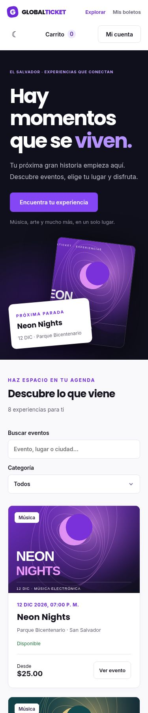
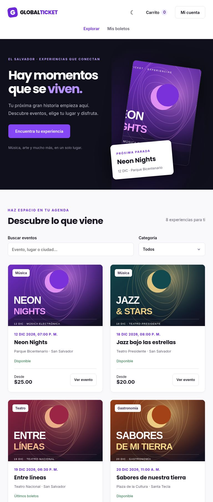
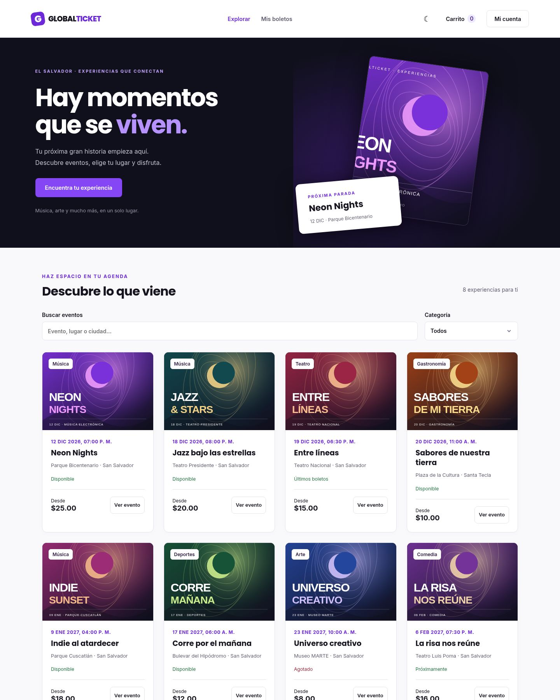

# Capturas de GLOBALTICKET K

Capturas de la base de Lijian a 375, 768 y 1440 píxeles. Se usó el navegador con un marco de la aplicación a cada ancho exacto y 1800 px de alto; se capturó ese marco sin reescalar las imágenes. No se utilizaron las capturas anteriores. En cada vista se comprobó que el ancho del documento coincide con el ancho disponible, sin desborde horizontal de página.

La compra de ejemplo usa Cliente Demo, cliente@example.com, dos boletos VIP de Neon Nights y un total de $120.00. Los QR y órdenes son de demostración. El panel muestra una compra local. El navegador comparte sus datos de prueba entre las vistas.

El inicio de sesión aún no está integrado en esta base. Ariana debe añadir la evidencia de su formulario después de subirlo.

| Pantalla | Móvil 375 px | Tablet 768 px | Escritorio 1440 px |
| --- | --- | --- | --- |
| Catálogo | [375 px](capturas/catalogo-375.jpg) | [768 px](capturas/catalogo-768.jpg) | [1440 px](capturas/catalogo-1440.jpg) |
| Crear cuenta | [375 px](capturas/registro-375.jpg) | [768 px](capturas/registro-768.jpg) | [1440 px](capturas/registro-1440.jpg) |
| Detalle y zonas | [375 px](capturas/detalle-375.jpg) | [768 px](capturas/detalle-768.jpg) | [1440 px](capturas/detalle-1440.jpg) |
| Carrito | [375 px](capturas/carrito-375.jpg) | [768 px](capturas/carrito-768.jpg) | [1440 px](capturas/carrito-1440.jpg) |
| Pago simulado | [375 px](capturas/pago-375.jpg) | [768 px](capturas/pago-768.jpg) | [1440 px](capturas/pago-1440.jpg) |
| Boletos QR | [375 px](capturas/boletos-375.jpg) | [768 px](capturas/boletos-768.jpg) | [1440 px](capturas/boletos-1440.jpg) |
| Administración | [375 px](capturas/administracion-375.jpg) | [768 px](capturas/administracion-768.jpg) | [1440 px](capturas/administracion-1440.jpg) |

## Vista previa

